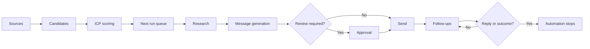

The Sales Agent is a sequence of guarded steps. A contact advances only when the facts needed for the next step exist and no stop condition applies.

## The five control layers

### 1. Sources decide who can enter

You can supply Sales Navigator searches or lists, import a CSV, search for contacts at companies already in the dashboard, or add people and companies by hand. The blacklist is checked before new people are accepted.

### 2. Targeting decides who is eligible

The agent evaluates candidates against your ideal customer profile (ICP). Structured criteria and relative weights produce a 0–100 score. The pipeline threshold can hold low-scoring contacts outside outreach.

A search result is not a promise of ICP fit. The agent may need to inspect more candidates to find the people who satisfy granular filters.

### 3. Per-seat settings decide how work is performed

Each seat has its own owner, connected accounts, schedule, channel choice, daily action limits, sign-offs, and writing style. Client-wide rules, which only admins change, control follow-up counts, approvals, inactive-profile handling, and the shared messaging playbook. See [Seats, roles, and accounts](/getting-started/seats-and-accounts).

### 4. Queue rules decide what happens next

The **Next run** cards show how many contacts are ready for each step: **New Prospects**, **Message**, **Outreach**, **Follow-up Email**, and **Follow-up LinkedIn**. Each card is capped by the relevant daily limit.

### 5. Replies and outcomes stop automation

A detected reply on either channel stops follow-ups across both channels. A person can also set an outcome such as **Meeting**, **Offer Sent**, or **Not interesting**. Every outcome removes the prospect from automated work.

<Note>
  Pipeline stages are derived from recorded activity. You do not manually move a prospect from **Invite Sent** to **Connected** or **Messaged**. You set an [outcome](/operate/stages-and-outcomes) when human judgment is required.
</Note>

## Channels work together

Each seat's **LinkedIn outreach** setting is **Both together**, **LinkedIn first**, or **Off**. With **LinkedIn first**, the connection request goes out before the first email; prospects you cannot reach on LinkedIn are emailed right away, and anyone still waiting after a week is emailed too. With **Off**, email outreach still runs. If a LinkedIn path becomes unavailable, an eligible email path can continue. A reply on either channel closes the automated sequence.

Read the [pipeline stage reference](/reference/pipeline-stages) for every label shown in the dashboard.

<Card title="Explore the complete agent flow" icon="route" href="/getting-started/agent-flow">
  Change channels, approvals, schedules, follow-ups, and human handoffs in an interactive pipeline view.
</Card>
